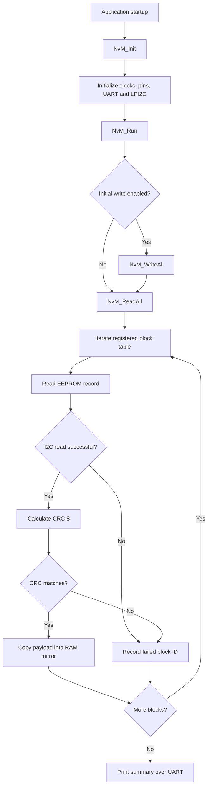

<div align="center">

# 🧠 NvM Read-All-at-Startup

### Exercise 19 · EEPROM restore, CRC-8 validation and failed-block reporting on the NXP S32K144

[](https://en.cppreference.com/w/c)
[](https://www.nxp.com/)
[](#hardware-and-software)
[](#testing-and-validation)
[](#known-limitations)

**A simplified, NvM-style Read-All operation: read blocks from an I²C EEPROM, verify them with CRC-8, restore valid data into RAM mirrors, and report failures over UART.**

[Overview](#overview) · [How it works](#how-it-works) · [Memory layout](#memory-layout) · [Testing](#testing-and-validation) · [Build](#build-and-run) · [Limitations](#known-limitations)

</div>


---

## Overview

After an ECU reset or power cycle, application data often has to be restored from non-volatile memory. This project implements that startup step on an **NXP S32K144** with an **external I²C EEPROM**.

The firmware walks a table of registered blocks and, for each one:

1. Reads the record from EEPROM through the LPI2C master driver.
2. Calculates CRC-8 over the payload and compares it with the stored CRC.
3. Copies the payload into its RAM mirror **only if** the CRC matches.
4. Adds the block ID to a failed-block list on an I²C error or CRC mismatch.
5. Prints the failed-block count and IDs over UART.

### Objectives

| | Goal |
|---|---|
| 🔁 | Iterate over registered blocks using a configuration table |
| 📥 | Read EEPROM records through the LPI2C driver |
| ✅ | Verify each payload with CRC-8 |
| 💾 | Restore valid payloads into RAM mirrors |
| ⚠️ | Record failed block IDs (read failures and CRC mismatches) |
| 🖥️ | Report results over UART |

---

## How it works



> The application must call `NvM_Init()` and then `NvM_Run()` for this sequence to occur.

### Code map

| Function / object | Responsibility |
|---|---|
| `NvM_Init()` | Initializes clocks, pins, LPUART and LPI2C |
| `NvM_BlockType` | Describes a block: ID, EEPROM address, RAM mirror pointer, payload length |
| `NVM_Blocks[]` | Registers the blocks processed by Read-All |
| `EEPROM_Read()` | Reads a record from EEPROM over LPI2C |
| `EEPROM_WriteRecord()` | Writes a record and waits for the EEPROM write cycle |
| `CalculateCRC()` | Calculates the configured CRC-8 over payload bytes |
| `NvM_ReadAll()` | Reads each record, validates CRC, restores valid payloads, records failures |
| `NvM_PrintResults()` | Prints the failed-block count and IDs over UART |
| `NvM_Run()` | Optionally writes initial data, then runs Read-All and prints results |

---

## Memory layout

Three blocks are registered, each with a three-byte initial payload.

| Block ID | Initial payload | RAM mirror |
|:---:|:---:|---|
| 1 | `08 05 06` | `RAM_Mirror1` |
| 2 | `20 06 07` | `RAM_Mirror2` |
| 3 | `01 01 07` | `RAM_Mirror3` |

Addresses are set through `BLOCK1_ADDRESS`, `BLOCK2_ADDRESS` and `BLOCK3_ADDRESS`.

**Record format** (`BLOCK_LENGTH = 3`, `RECORD_SIZE = 4`):

```text
┌──────────┬──────────┬──────────┬──────────┐
│ Byte 0   │ Byte 1   │ Byte 2   │ Byte 3   │
│ Payload  │ Payload  │ Payload  │ CRC-8    │
└──────────┴──────────┴──────────┴──────────┘
```

---

## CRC-8 validation

| Parameter | Value |
|---|---|
| Initial value | `0xFF` |
| Polynomial | `0x07` |
| Input | Payload bytes only |
| Stored CRC | Byte at index `BLOCK_LENGTH` |

- **Match:** the payload is copied into the RAM mirror.
- **Mismatch:** the block ID is added to the failed list and the payload is **not** copied.

> [!IMPORTANT]
> CRC detects accidental corruption. It is not encryption, authentication or a security boundary.

---

## Hardware and software

| Hardware | Software |
|---|---|
| NXP S32K144 evaluation board | S32 Design Studio |
| External I²C EEPROM *(part number to be documented)* | S32K144 SDK and generated peripheral configuration |
| USB connection for programming/debugging | LPI2C and LPUART SDK drivers |
| UART connection or onboard UART bridge | Embedded C, Git and GitHub |

> [!TIP]
> Before tagging a validated release, record the board revision, EEPROM part number, SDK version, compiler version and configured I²C address.

---

## Testing and validation

The results below were captured on real hardware.

### 1. Test setup

<p align="center">
  
  <br/><em>S32K144 board connected to the external I²C EEPROM</em>
</p>

### 2. Valid records

<p align="center">
  
  <br/><em>UART output when all records pass the CRC check</em>
</p>

### 3. Fault injection: corrupted CRC

<p align="center">
  
  <br/><em>UART output after deliberately corrupting a stored CRC; the affected block is reported as failed</em>
</p>

### Results summary

| # | Test | Expected result | Observed | Status |
|:-:|---|---|---|:-:|
| 1 | All records valid | Failed count = 0; mirrors restored | See screenshot 2 | ✅ |
| 2 | One CRC deliberately corrupted | Failed count = 1; block ID listed; mirror not updated | See screenshot 3 | ✅ |
| 3 | I²C read failure *(e.g. EEPROM disconnected)* | Failed block IDs reported | Not yet tested | ⬜ |

---

## Build and run

1. Open the project in **S32 Design Studio**.
2. Confirm the target device, SDK configuration, I²C instance, EEPROM address and block addresses.
3. Build the project and resolve any compiler or linker errors.
4. Program the S32K144 board.
5. Make sure the application calls `NvM_Init()` **before** `NvM_Run()`.
6. Open a serial terminal on the UART port and observe the output.
7. Inspect the RAM mirrors and failed-block list in the debugger.

> [!WARNING]
> **Preserve stored data during Read-All testing.** When `WRITE_INITIAL_DATA == 1U`, `NvM_Run()` calls `NvM_WriteAll()` *before* `NvM_ReadAll()`, which overwrites the records you want to read back. To test restoration of previously stored data, set `WRITE_INITIAL_DATA` to `0U`, then run Read-All.

---

## Repository structure

> Adjust this tree to match the files actually present in your S32 Design Studio project. Keep the generated SDK and build configuration files the project needs.

```text
Read-All-at-Startup/
├── Sources/            # Application source (main.c, NvM, EEPROM, CRC)
├── Generated_Code/     # Generated SDK / peripheral configuration
├── Project_Settings/   # Linker, startup and debugger settings
├── docs/               # Screenshots and supporting documentation
└── README.md
```

---

## Known limitations

- Failures are **recorded but not recovered**: no default-value restoration is implemented.
- `Failed_Blocks` must have capacity for every possible failure. Make sure `NVM_BLOCK_COUNT` and the failure counter types cannot overflow.
- The code sends only the **low eight bits** of the address as the memory address. EEPROMs with larger address spaces may need extra device-address bits or address bytes.
- Confirm that record length, EEPROM page size and block addresses are consistent with the selected EEPROM.
- Check the read routine against the exact EEPROM's random-read protocol and required bus conditions.
- The I²C failure path has not yet been exercised on hardware.

---

## Future enhancements

- [ ] Per-block status and failure-reason codes
- [ ] Configurable recovery / default data handling
- [ ] Repeatable fault-injection tests for CRC mismatch and I²C failures
- [ ] Requirements-to-test traceability table
- [ ] Separate memory access, CRC and block-management logic into independently testable modules
- [ ] Extend toward AUTOSAR NvM concepts using the relevant specifications

---

## References

- NXP S32K1xx reference manual and device documentation
- S32 Design Studio and S32K144 SDK documentation
- Datasheet for the specific EEPROM used in the hardware setup

---

## Author

**Haritha Kanakam**
Electronics and Communication Engineering · Aspiring Automotive Embedded Engineer

[](https://github.com/harithakanakam7)
[](https://harithakanakam.netlify.app)
[](https://www.linkedin.com/in/kharitha07/)

<div align="center">
<sub>This README separates code-level behavior from results measured on hardware.</sub>
</div>
