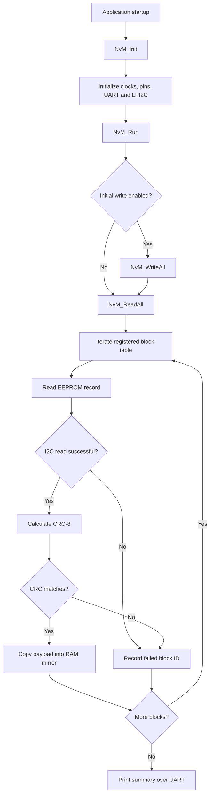

# Exercise 19: NvM Read-All-at-Startup

[](https://en.cppreference.com/w/c)
[](https://www.nxp.com/)
[](#implementation-status)
[](#testing-and-validation)

**An embedded C exercise implementing EEPROM Read-All, RAM-mirror restoration, CRC-8 validation, and failed-block reporting over UART.**

> **Project status:** In development. The source code has been reviewed for documentation purposes, but hardware results have not been independently verified.

## Table of Contents

- [Overview](#overview)
- [Problem Statement](#problem-statement)
- [Objectives](#objectives)
- [Hardware and Software](#hardware-and-software)
- [Architecture](#architecture)
- [Implementation Details](#implementation-details)
- [Registered Memory Blocks](#registered-memory-blocks)
- [CRC-8 Validation](#crc-8-validation)
- [Testing and Validation](#testing-and-validation)
- [Build and Run](#build-and-run)
- [Repository Structure](#repository-structure)
- [Known Limitations and Review Notes](#known-limitations-and-review-notes)
- [Future Enhancements](#future-enhancements)
- [Author](#author)

## Overview

This project implements a simplified NvM-style Read-All operation for an embedded ECU application using an NXP S32K144 microcontroller and an external I²C EEPROM.

The firmware iterates over a registered block table, reads each block record from EEPROM, validates the payload using CRC-8, and copies valid payload bytes into the associated RAM mirror. If an I²C read fails or the CRC does not match, the block ID is added to a failed-block list and the outcome is reported through UART.

This is an educational implementation inspired by automotive non-volatile memory management concepts. It is **not represented as a fully AUTOSAR-compliant NvM module**.

## Problem Statement

After an ECU reset or power cycle, application data may need to be restored from non-volatile memory. The software should read each configured block, check data integrity, restore valid data into RAM, and identify blocks that could not be restored successfully.

## Objectives

- Iterate over registered blocks using a block configuration table.
- Read EEPROM records through the LPI2C master driver.
- Verify each record's payload using CRC-8.
- Copy valid payloads into their associated RAM mirrors.
- Record failed block IDs for read failures and CRC mismatches.
- Report the failed-block count and IDs over UART.

## Hardware and Software

### Hardware

- NXP S32K144 evaluation board
- External I²C EEPROM (exact part number to be documented)
- USB connection for programming/debugging
- UART connection or onboard UART bridge for diagnostic output, as applicable

### Software

- S32 Design Studio
- S32K144 SDK and generated peripheral configuration
- Embedded C
- LPI2C and LPUART SDK drivers
- Git and GitHub

**Before publishing a validated release:** record the exact board revision, EEPROM part number, SDK version, compiler version, and configured I²C address.

## Architecture



The diagram describes the flow implied by the supplied code. The application must call `NvM_Init()` and then `NvM_Run()` for this sequence to occur.

## Implementation Details

| Function / object | Responsibility |
|---|---|
| `NvM_Init()` | Initializes clocks, pins, LPUART, and LPI2C |
| `NvM_BlockType` | Describes a block ID, EEPROM address, RAM mirror pointer, and payload length |
| `NVM_Blocks[]` | Registers the blocks processed by Read-All |
| `EEPROM_Read()` | Reads a record from EEPROM over LPI2C |
| `EEPROM_WriteRecord()` | Writes a record and waits for the EEPROM write cycle |
| `CalculateCRC()` | Calculates the configured CRC-8 over payload bytes |
| `NvM_ReadAll()` | Reads each registered record, validates CRC, restores valid payloads, and records failures |
| `NvM_PrintResults()` | Prints the failed-block count and IDs over UART |
| `NvM_Run()` | Optionally writes initial data, then executes Read-All and prints results |

## Registered Memory Blocks

The supplied code defines three registered blocks and three-byte initial payloads.

| Block ID | Initial payload | RAM mirror |
|---:|---|---|
| 1 | `08 05 06` | `RAM_Mirror1` |
| 2 | `20 06 07` | `RAM_Mirror2` |
| 3 | `01 01 07` | `RAM_Mirror3` |

The addresses are configured through `BLOCK1_ADDRESS`, `BLOCK2_ADDRESS`, and `BLOCK3_ADDRESS`. The table above describes configured initial data, **not measured EEPROM readback**.

With `BLOCK_LENGTH = 3` and `RECORD_SIZE = 4`, each record consists of three payload bytes followed by one CRC byte.

## CRC-8 Validation

The supplied `CalculateCRC()` function uses:

- Initial value: `0xFF`
- Polynomial: `0x07`
- Input: payload bytes only
- Stored CRC: byte at index `BLOCK_LENGTH`

The firmware compares the stored CRC with the calculated CRC. On a match, it copies the payload into the RAM mirror. On a mismatch, it records the block ID as failed and does not copy that record's payload into the mirror.

CRC is an error-detection mechanism; it is not encryption, authentication, or a security boundary.

## Testing and Validation

The following tests are proposed. Update the status and attach real evidence only after running them on the target setup.

| Test | Expected behavior | Status |
|---|---|---|
| Valid record | CRC matches and payload is restored to the correct RAM mirror | Not yet documented |
| Corrupted CRC byte | Block is reported as failed; invalid payload is not copied | Not yet documented |
| I²C read failure | Block ID is recorded as failed | Not yet documented |
| All records valid | Failed-block count is zero and success message is printed | Not yet documented |
| Multiple invalid records | Each failed block ID is reported | Not yet documented |
| Read-All with initial writes disabled | Existing EEPROM contents are read without being overwritten first | Not yet documented |

### Evidence to add

Place genuine project evidence in `docs/images/` and link it here:

- `docs/images/hardware-setup.jpg` — actual board and EEPROM setup
- `docs/images/uart-valid-read.png` — actual UART output for valid records
- `docs/images/uart-crc-failure.png` — actual UART output after deliberately corrupting a CRC

Do not use illustrative or stock images as evidence that your hardware test passed. If evidence has not been captured yet, leave these files out until available.

## Build and Run

1. Open the project in S32 Design Studio.
2. Confirm the target device, SDK configuration, I²C instance, EEPROM address, and block address definitions.
3. Build the project and resolve any compiler or linker errors.
4. Program the S32K144 board.
5. Configure the application to call `NvM_Init()` before `NvM_Run()`.
6. Observe UART output and inspect RAM mirrors and the failed-block list in the debugger.
7. Record the actual output for each test in the validation table.

### Important: preserve stored data during Read-All testing

In the supplied code, `NvM_Run()` calls `NvM_WriteAll()` when `WRITE_INITIAL_DATA == 1U`, before it calls `NvM_ReadAll()`. This overwrites the configured records before reading them. To test restoration of previously stored data, disable the initial write and then execute Read-All.

## Repository Structure

Adapt this example to match the files actually present in the S32 Design Studio project; do not remove generated SDK or build configuration files required by the project.

```text
nvm-read-all-startup/
├── src/
│   ├── main.c
│   └── nvm.c
├── include/
│   └── nvm.h
├── docs/
│   ├── architecture.md
│   ├── test-plan.md
│   └── images/
├── README.md
└── LICENSE                 # Add only after choosing a license
```

## Known Limitations and Review Notes

- Hardware execution and validation results have not been provided yet.
- The implementation records failed block IDs but does not implement recovery or default-value restoration.
- `Failed_Blocks` must have enough capacity for every possible failure; ensure `NVM_BLOCK_COUNT` and the failure counter types cannot overflow for the configured project.
- Confirm the EEPROM's addressing scheme. The supplied code sends only the low eight bits of the address as the memory address; EEPROMs with larger address spaces may require additional device-address bits or address bytes.
- Confirm the configured record length, EEPROM page size, and block addresses are consistent with the selected EEPROM.
- The read routine should be checked against the exact EEPROM's random-read protocol and required bus conditions.
- A CRC mismatch is detected, but no per-block recovery strategy is implemented.
- This is an educational project, not a production-ready ECU memory-management implementation.

## Future Enhancements

- Add explicit per-block status and failure-reason codes.
- Implement configurable recovery/default data handling.
- Add repeatable fault-injection tests for CRC mismatch and I²C failures.
- Add a requirements-to-test traceability table.
- Separate memory access, CRC, and block-management logic into independently testable modules.
- Extend the implementation toward AUTOSAR NvM concepts using the relevant specifications.

## Author

**Haritha Kanakam**  
Electronics and Communication Engineering | Aspiring Automotive Embedded Engineer

- GitHub: [@harithakanakam7](https://github.com/harithakanakam7)
- Portfolio: [harithakanakam.netlify.app](https://harithakanakam.netlify.app)
- LinkedIn: [Haritha Kanakam](https://www.linkedin.com/in/kharitha07/)

## References

- NXP S32K1xx reference manual and device documentation
- S32 Design Studio and S32K144 SDK documentation
- Documentation for the specific EEPROM used in the hardware setup

---

*This README distinguishes code-level implementation from hardware behavior that still needs to be measured and documented.*

